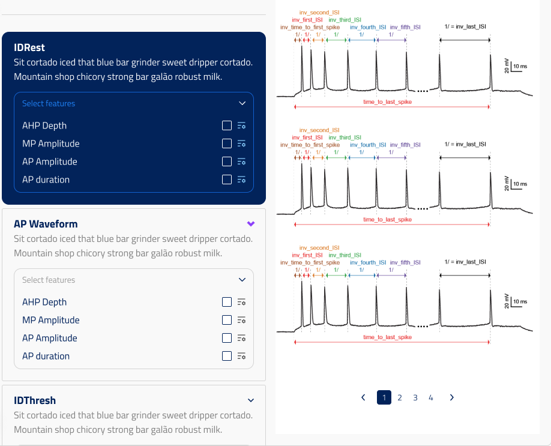

## select_efeatures_by_protocol

ui_element: `select_efeatures_by_protocol`

Backs [`SelectEFeaturesByProtocol`](../../../../obi_one/scientific/tasks/emodel_building/task1_efeature_extraction/blocks/protocol_and_feature_selection.py) — a single object that lets the user choose, per ephys protocol, which eFEL features to extract and at which stimulus amplitudes, with editable per-protocol and per-feature eFEL settings.

The object's `protocols` field is a tuple of concrete protocol classes. Each protocol carries:

- `features`: a discriminated union of exactly the eFEL features that protocol can
  extract, so the schema itself states the valid features per protocol (there is no
  separate catalogue extra).
- `extraction_amplitudes`: `(amplitude, is_validation)` pairs — the amplitudes to
  extract, in nA (from the `AmplitudesByProtocol` property of the
  [`/declared/mapped-electrical-cell-recording-properties`](../../../../app/endpoints/electrical_cell_recording_properties.py)
  endpoint), or in % of rheobase when the settings' `amplitude_mode` is `relative` (from
  `RelativeAmplitudesByProtocol`). The boolean flags an amplitude as used for
  validation. See [Relative amplitudes](#relative-amplitudes).
- per-protocol eFEL overrides (`spike_detection_threshold`, `trace_resampling_timestep`)
  and stimulus timing (`stim_start`/`stim_end`/…). Timing left at 0 is taken per
  recording from its summary (`TimingByProtocol` shows it); a value set here applies to
  every recording.

Each feature in turn carries its own eFEL overrides (`spike_detection_threshold`,
`trace_resampling_timestep`, `stim_start`/`stim_end`). Unset (`null`) values inherit,
with precedence **feature > protocol > global**.

- The block field's `type` must be `"object"` — the field is a `$ref` to the object
  holding the selection, with the extras (`ui_element`, `property_endpoints`) as
  siblings of the `$ref`.
- The valid efeatures per protocol are read from each protocol's `features` union in
  the schema; there is no separate catalogue extra.
- The eFEL documentation base URLs used to deep-link a feature's docs/figures
  (`efel_doc_base_url`, `efel_figures_base_url`) live on the **config root**
  (`json_schema_extra_additions`), not on this field.
- The protocol and feature classes ship baked-in for the L5PC-style BluePyEModel
  protocols (`IDrest`, `IDthresh`, `IV`, `APWaveform`, `sAHP`, …).

### Relative amplitudes

The extraction settings' `amplitude_mode` decides whether every protocol's
`extraction_amplitudes` are in nA (`absolute`, the default) or in % of each recording's
rheobase (`relative`). Relative amplitudes run BluePyEModel's threshold-based pipeline
end to end:

- **Extraction** — bluepyefe computes each recording's rheobase from the sweeps of the
  settings' `rheobase_protocols` (with `rheobase_strategy`; with several protocols, the
  smallest of their rheobases) and matches every sweep by its own % of that rheobase,
  within `relative_amplitude_tolerance` percentage points.
- **Optimisation and validation** — every extracted protocol is a
  `ThresholdBasedProtocol`: each e-model is stimulated at the same % of its own
  threshold current, found by BluePyEModel's holding and threshold current searches.

The settings that only apply in relative mode (all protocols are `Protocol` type names):

| setting | default | UI element | targets added automatically |
|---|---|---|---|
| `rheobase_protocols` | `["IDThreshProtocol"]` | `entity_property_multi_select` on `RheobaseProtocols` | — (their sweeps give each recording's rheobase) |
| `rmp_protocol` at `rmp_amplitude` | `IVProtocol` at 0% | `entity_property_dropdown` on `Protocols`, `float_input` | `voltage_base` → resting membrane potential |
| `rin_protocol` at `rin_amplitude` | `IVProtocol` at −20% | `entity_property_dropdown` on `Protocols`, `float_input` | `voltage_base` → holding voltage, `ohmic_input_resistance_vb_ssse` → input resistance |

They must be step protocols; the RMP and input resistance protocols must be among the
selected ones, at different amplitudes when they are the same protocol. With relative
amplitudes, the targets are named by percent (e.g. `IDrest_250.0`), which is also how
validation protocols are named.

The task stops before extraction when a recording has no usable rheobase from the
`rheobase_protocols` (`RheobaseByRecording` is `null` for it), and after extraction
when a recording contributed to no target.

### Endpoint data

The widget, the amplitudes and the relative-mode settings are all fed by
`GET /declared/mapped-electrical-cell-recording-properties?recording_ids=…&rheobase_protocols=…`,
which returns a dictionary keyed by `ElectricalCellRecordingMappedProperties`. Every
value comes from the recordings' `recording_summary` assets (see
[Recording summary](../../../recording-summary.md)); a recording without one has its NWB
file downloaded and parsed instead. `rheobase_protocols` (repeatable, `Protocol` type
names, default `IDThreshProtocol`) is the settings' `rheobase_protocols`: the frontend
calls the endpoint again when it changes.

| key | value |
|---|---|
| `Protocols` | sorted union of the matching `Protocol` **class names** across the recordings (e.g. `"IDRestProtocol"`), matching each protocol's `type` discriminator |
| `ProtocolsByRecording` | `{recording_id: [protocol class name, …]}` |
| `AmplitudesByProtocol` | `{protocol class name: [amplitude (nA), …]}` — the amplitude each eCode matches targets on (the short middle step for the sAHP family, the first step for HyperDePol/DeHyperPol, the peak for ramps and cheops), unioned over the recordings |
| `TimingByProtocol` | `{protocol class name: {"ton" \| "tmid" \| "tmid2" \| "toff": [ms, …]}}` — the stimulus times detected in the recordings, unioned; several values mean recordings (or sweeps) differ. For display: extraction uses each recording's own timing |
| `RheobaseProtocols` | protocol class names with a positive rheobase in at least one recording: the options of `rheobase_protocols` |
| `RelativeAmplitudesByProtocol` | `{protocol class name: [% of rheobase, …]}` — each recording's amplitudes divided by its own rheobase from `rheobase_protocols`, unioned; recordings without one do not contribute |
| `RheobaseByRecording` | `{recording_id: rheobase (nA) \| null}` — each recording's rheobase from `rheobase_protocols` (the smallest of theirs, bluepyefe `absolute` strategy); `null` when none fires or one fires at 0 nA or below, so the recording cannot be used in relative mode |

That one endpoint is wired into the config through its `property_group`
(`"ElectricalCellRecordings"`, mapped to the endpoint by the config's top-level
`property_endpoints`):

- **Protocols** — this `select_efeatures_by_protocol` field declares
  `property_endpoints: "declared/mapped-electrical-cell-recording-properties"`. The
  frontend reads `Protocols` / `ProtocolsByRecording` to decide which protocol boxes
  to render, mapping the class names onto the entries of the `protocols` tuple (by
  their `type` discriminator).
- **Amplitudes** — each protocol's `extraction_amplitudes` field declares
  `property: "AmplitudesByProtocol"`. The frontend offers
  `AmplitudesByProtocol[<protocol class name>]` in absolute mode and
  `RelativeAmplitudesByProtocol[<protocol class name>]` in relative mode (each paired
  with an `is_validation` flag), and drops selected amplitudes no longer offered when
  the mode or the rheobase protocols change.
- **Relative-mode settings** — `rheobase_protocols` reads `RheobaseProtocols`;
  `rmp_protocol` and `rin_protocol` read `Protocols`.

### Example Pydantic implementation

```py
class ProtocolAndFeatureSelection(Block):
    selection: SelectEFeaturesByProtocol = Field(
        default_factory=SelectEFeaturesByProtocol,
        title="E-features by protocol",
        description="...",
        json_schema_extra={
            SchemaKey.UI_ELEMENT: UIElement.SELECT_EFEATURES_BY_PROTOCOL,
            SchemaKey.PROPERTY_ENDPOINTS: "declared/mapped-electrical-cell-recording-properties",
        },
    )
```

### User flow

1. Frontend calls `/declared/mapped-electrical-cell-recording-properties` with the
   selected `ElectricalCellRecording` ids (and, in relative mode, the
   `rheobase_protocols`); reads `Protocols` (the union of protocol **class names**,
   matching each protocol's `type` discriminator) and `AmplitudesByProtocol` or
   `RelativeAmplitudesByProtocol` (also keyed by protocol class name).
2. Frontend renders a box per protocol in the union, listing that protocol's catalogue
   features (from its `features` union) with checkboxes, together with the discovered
   amplitudes.
3. The user activates features and amplitudes and optionally overrides the per-protocol
   and per-feature eFEL settings.

### UI design


