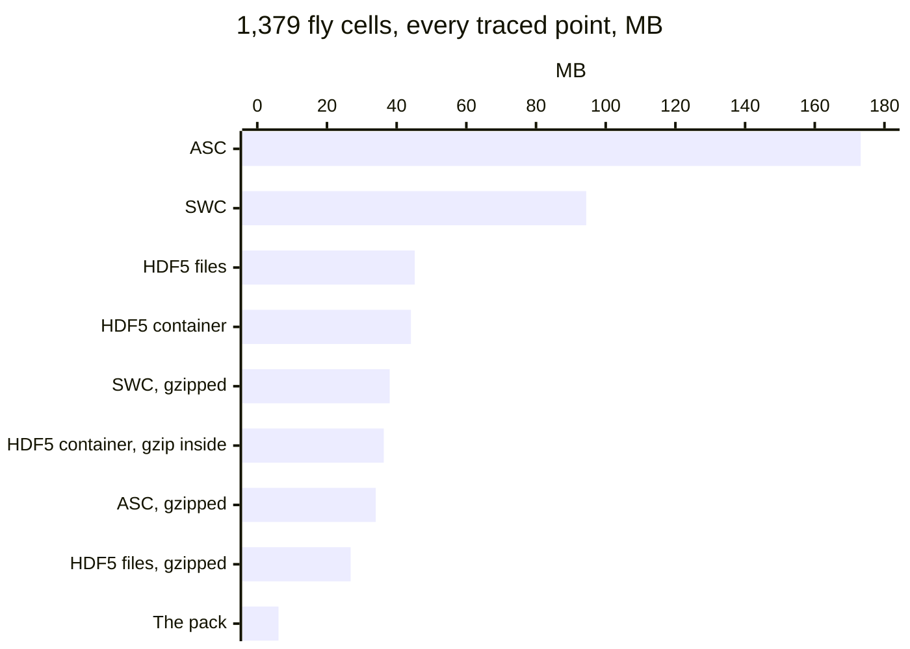
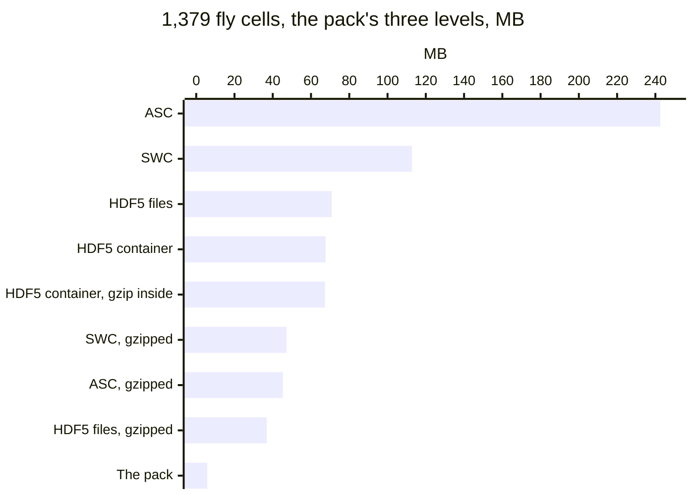
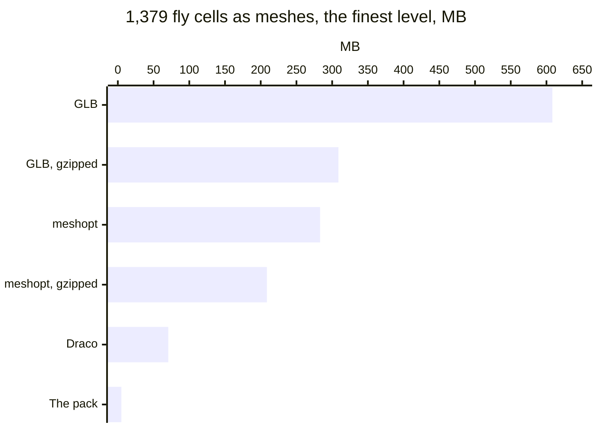
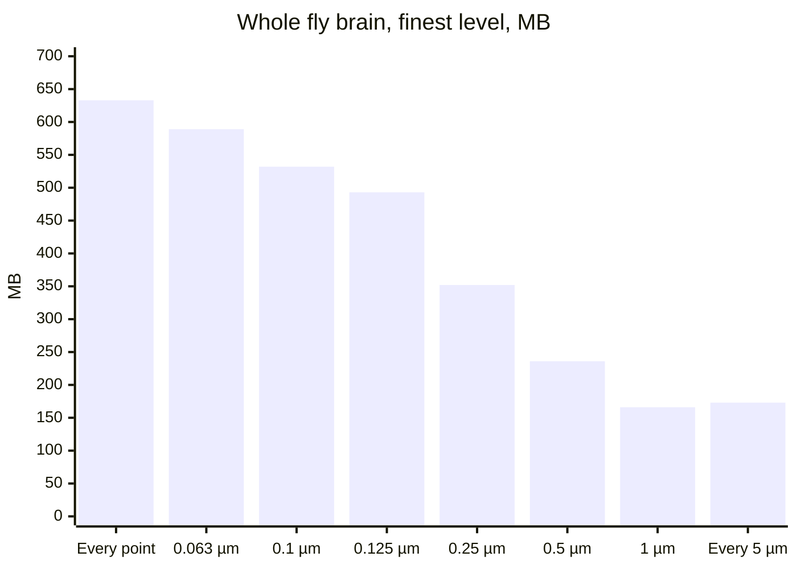
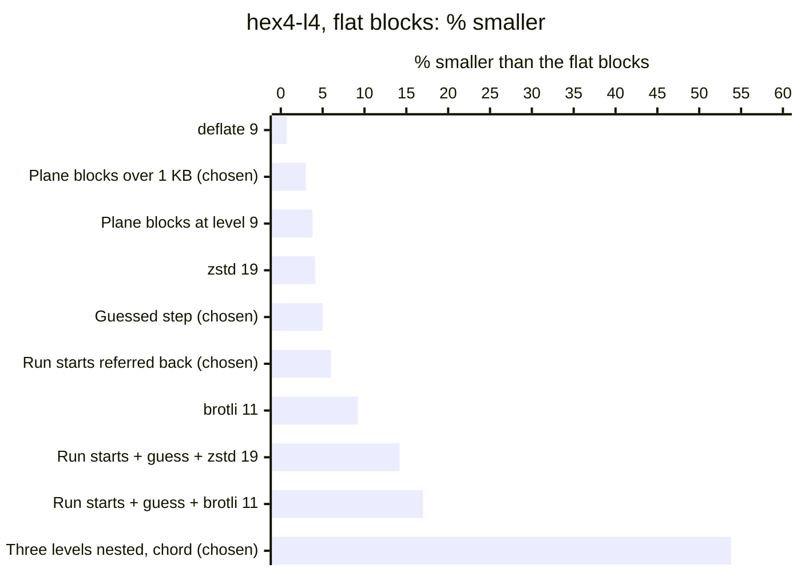
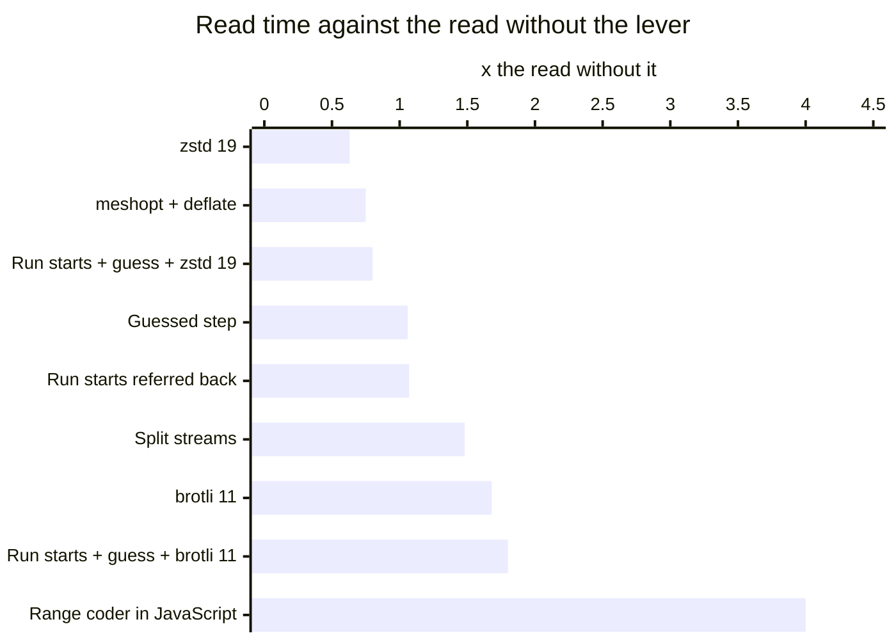
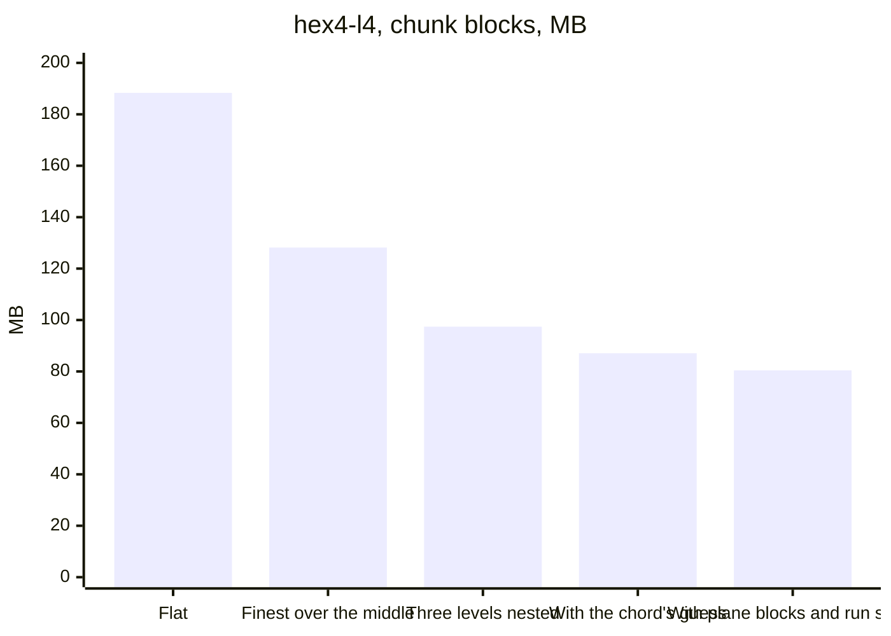

# Alternatives weighed

Every option weighed for the pack, area by area: what it gave on the pack it was measured on, what it costs to read, what it would take, and its verdict. The decisions are recorded in the ADRs, named here by number.

## How to read the tables

Each table names its baseline in a line above it. There are three:

- **The per-morphology packs of the first review.** The 1,379-cell fly sample, a deflate block a morphology at level 9, on the 25 nm grid. Times 100.5 it stands for the whole fly brain: 493 MB at the finest level, within 0.125 µm.
- **The flat blocks.** Every level written whole, each chunk one zlib stream at level 6, with no plane blocks and no nesting. hex4-l4 has 188.3 MB of chunk blocks.
- **The nested stack.** Each level held as additions over its base, as the pack holds them.

A row measured on another pack names that pack in its gain. Read costs are Node on one thread, inflate and decode, each against its own run's baseline, unless a row says otherwise.

Most coders, the grids and the chunk sizes were measured on the flat blocks. zstd, brotli, the context coders and meshopt were never measured on the additions blocks of nesting. Nesting took away the finest and middle levels' run streams, and with them much of what those coders gained, so their gains cannot be taken off the pack's file. The plane blocks and the run starts were measured again on the nested blocks, and their rows say so.

The packs: hex4-l4 (nbS1, 5,030 cells), hex6-l1 (349 cells), CA1-300 (rat CA1, 300 cells), flywire-sugar (243 FlyWire cells), the 1,379-cell fly sample and the 291-cell rat sample (layer 1 of an nbS1 column). Two packs made of copies of the fly sample were measured too. Copies of one cell in one chunk give a coder repeats that no real circuit has, so their figures are left out.

Where an option says "writer and reader", the reader would change with it.

## 1. Representation

Baseline: the per-morphology packs of the first review, every traced point of the 1,379-cell fly sample, deflate at level 9, in bytes a point. From floats to the sections' shape, each row adds one step to the row above. The pack is deflated at level 6.

| Option | Gain or loss | Read cost | What it would take | Verdict |
| --- | --- | --- | --- | --- |
| SWC text | 45-51 B a point; 17.5 deflated | parsed in 0.6-0.7 s, against 68-75 ms for the pack | nothing | Rejected ([ADR 0001](adr/0001-one-pack-built-by-obi-one.md)) |
| HDF5 as stored | the 291-cell rat sample: 43.9 MB, against 8.13 MB as a pack | a container reader in the browser | nothing | Rejected ([ADR 0001](adr/0001-one-pack-built-by-obi-one.md)) |
| Floats: x, y, z, radius and the parent | 20 B a point; 13.3 deflated | none to speak of | nothing | Rejected ([ADR 0003](adr/0003-grid-and-radius-steps.md)) |
| Whole numbers on the grid | 18 B a point; 9.73 deflated | one multiplication | the grid | Chosen ([ADR 0003](adr/0003-grid-and-radius-steps.md)) |
| Steps from the parent, a point a record | 9 B a point; 4.05 deflated | a running sum | | Chosen ([ADR 0006](adr/0006-byte-planes-deflated.md)) |
| A field a stream | 3.42 deflated | | | Chosen ([ADR 0006](adr/0006-byte-planes-deflated.md)) |
| Each stream as byte planes | 2.97 deflated | no branch a number | one numpy call a stream | Chosen ([ADR 0006](adr/0006-byte-planes-deflated.md)) |
| The sections' shape in place of a parent a point | 7.1-7.6 B a point; 2.93 deflated | a running sum along each section | | Chosen for a block a morphology; chunks hold runs instead ([ADR 0002](adr/0002-chunks-of-space.md)) |
| An offset from the soma | +43% (702 MB against 493, whole fly brain at 0.125 µm); the rat's +30% | not timed | | Rejected ([ADR 0003](adr/0003-grid-and-radius-steps.md)) |
| An offset from the section's first point | +25% (618 MB); the rat's +24% | not timed | | Rejected ([ADR 0003](adr/0003-grid-and-radius-steps.md)) |
| Forks as a count of children a section | -1.0% (487 MB); the rat's -0.3% | 23.6 against 23.5 ms per million points | a stack in the reader | Rejected: chunks hold runs ([ADR 0002](adr/0002-chunks-of-space.md)) |
| Forks as a tag of 2 bits a point | +0.2% | 25.4 ms per million points | | Rejected ([ADR 0002](adr/0002-chunks-of-space.md)) |
| Fields just wide enough, bits packed across bytes | +12% with no coder, +10% deflated | | | Rejected ([ADR 0006](adr/0006-byte-planes-deflated.md)) |
| 16 bits over each morphology's own box | about +1.3 B a point on the fly cells, +0.4 on the rat's, from the slope, not measured | | | Rejected ([ADR 0003](adr/0003-grid-and-radius-steps.md)) |

- **Steps are the largest gain:** 9.73 to 4.05 B a point. A position needs two or three bytes an axis; the step to the next point of a fibre mostly fits in one. Half the steps on an axis are under 11-13 grid steps, and half the offsets from the soma are over 982-1,370 grid steps.
- **A field a stream, then byte planes, take 4.0 to 3.0 B.** Deflate codes a byte by how often it comes, and with the low bytes apart from the high bytes, which are nearly all zero, each stream has few values that come often.
- **Gzip alone is not enough.** SWC text deflates to six times the pack, and floats still take 12-14 B a point: their low bits look like noise to a coder.
- **Bits packed across bytes leave deflate nothing to line up.** Byte planes then deflate already take the empty high bits out.

### The same cells in other formats

Measured on 2026-10-23 on the M4 Pro.

**The cells:** the 1,379-cell fly sample as SWC files, 94.4 MB and 2.1M traced points. These SWC files are the sample rewritten from the bench's own copy, every neurite typed as a dendrite.

**How each format was written:**
- **SWC and ASC:** text, at 4 decimals, as the source files are.
- **HDF5:** in MorphIO's layout (`points`, `structure`, `metadata`), written with h5py, because MorphIO's own writer refuses these cells' one-point root sections.
- **An HDF5 container:** every morphology a group of one file, as a SONATA circuit stores them. It was written plain, and with gzip 6 and shuffle on every dataset at h5py's default chunking.
- **"Gzipped":** each file compressed by gzip 6, as it would travel.
- **The simplified levels:** simplified as the pack simplifies them. Each level was written as a tree whose polylines hang from the section that holds their first point.
- **The pack:** built by the writer, with its three levels, with the finest level alone, and with every point (tolerance 0).

The table gives every format, in MB:

| Format | Every traced point | The pack's three levels | The finest level alone |
| --- | --- | --- | --- |
| SWC | 94.4 | 112.8 | 64.7 |
| SWC, gzipped | 38.0 | 47.2 | 26.6 |
| ASC | 173.2 | 242.6 | 130.6 |
| ASC, gzipped | 34.0 | 45.3 | 24.7 |
| HDF5, a file a cell | 45.2 | 70.8 | 34.8 |
| HDF5, a file a cell, gzipped | 26.8 | 36.9 | 19.7 |
| HDF5 container | 44.1 | 67.6 | 33.7 |
| HDF5 container, gzip and shuffle inside | 36.3 | 67.3 | 29.7 |
| **The pack** | **6.1** | **5.8** | **4.9** |

With every traced point:

The same three levels the pack holds, in each format:

**Meshes.** As a GLB, each neurite is a tube of 8 sides, a ring a point with no caps, plus an icosphere a soma. Positions and normals are float32 and indices uint32.
- **meshopt:** its lossless vertex and index codecs, as `EXT_meshopt_compression` stores them, without quantization.
- **Draco:** at its usual glTF settings, positions in 14 bits and normals in 10 bits, which is lossy.

| Mesh | Every traced point | The finest level |
| --- | --- | --- |
| Vertices; triangles | 18.9M; 33.8M | 13.6M; 23.4M |
| GLB | 859.1 MB | 608.3 MB |
| GLB, gzipped | 431.0 MB | 308.8 MB |
| meshopt | 392.5 MB | 283.1 MB |
| meshopt, gzipped | 286.5 MB | 208.6 MB |
| Draco | 93.2 MB | 70.6 MB |
| The pack, that level alone | 6.1 MB | 4.9 MB |

**What the numbers show:**
- **The pack's three levels take less than its every-point level.** Each finer level is held as what it adds to the coarser one. Every other format holds each level whole, so three levels cost it 1.2 to 2.3 times one level.
- **The pack is about six times smaller than the best general format.** For the same three levels, HDF5 a file a cell, gzipped, comes to 36.9 MB, against the pack's 5.8 MB. With every point it is 26.8 MB, against 6.1 MB: 4.4 times.
- **Simplifying the text first helps less than it seems.** At the finest level SWC is 64.7 MB, and 26.6 MB gzipped: still 5.4 times the pack's finest level alone.
- **Gzip inside an HDF5 container gains little,** and loses on the far level: from 8.9 to 13.8 MB, because every small dataset gets chunk indexes of its own. Float32 coordinates leave gzip little to find, where the pack's whole-number steps leave it much.
- **A mesh holds a surface, not a centre line.** Eight vertices a point with normals make a GLB over 100 times the pack. Draco brings it to 14 times the pack, and only by quantizing.
- **The pack is lossy too.** It holds a position to within 12.5 nm and a radius to within 2.2%. The text formats keep 0.1 nm and HDF5 keeps float32. A fair comparison of text or HDF5 to the pack at the same precision would also round those formats to the grid. That was not measured.

## 2. Simplification

Baseline: the per-morphology packs of the first review, the whole fly brain as the 1,379-cell sample times 100.5: 633 MB at every point, 212M points. Every row is read by the same reader.

| Option | Gain or loss | Read cost | What it would take | Verdict |
| --- | --- | --- | --- | --- |
| Every point | 633 MB; 3.39 GB as segments on the GPU | same reader | nothing | Rejected ([ADR 0004](adr/0004-simplification-tolerance.md)) |
| Within 0.063 µm, the morphology viewer's tolerance | -7% (589 MB) | same reader | a setting | Rejected ([ADR 0004](adr/0004-simplification-tolerance.md)) |
| Within 0.1 µm | -16% (532 MB) | same reader | a setting | Rejected ([ADR 0004](adr/0004-simplification-tolerance.md)) |
| Within 0.125 µm | -22% (493 MB); 2.34 GB on the GPU | same reader | a setting | Chosen, the finest level ([ADR 0004](adr/0004-simplification-tolerance.md)) |
| Within 0.25 µm | -44% (352 MB) | same reader | a level | Chosen, the middle level ([ADR 0005](adr/0005-three-levels.md)) |
| Within 0.5 µm | -63% (236 MB) | same reader | a level | Rejected ([ADR 0005](adr/0005-three-levels.md)) |
| Within 1 µm | -74% (166 MB) | same reader | a level | Chosen, the far level, with end branches under 5 µm pruned ([ADR 0005](adr/0005-three-levels.md)) |
| The path alone within 0.1 µm, the diameter not held | -25% (473 MB) | same reader | morph_tool, already a dependency; 1 in 100 points then 0.149 µm or more off in radius, against 0.04 µm with it held | Rejected ([ADR 0004](adr/0004-simplification-tolerance.md)) |
| A point every 5 µm on every neurite | -73% (173 MB) | same reader | 67% of the traced points outside the tube drawn, the worst 2.19 µm off, 88.2% of the length kept | Rejected ([ADR 0004](adr/0004-simplification-tolerance.md)) |
| The fewest points the same test allows (Imai-Iri) | -2% at 0.125 µm (481 MB against 493); the rat's -8.5% | same reader | about 60 lines in the build; 5.8% of the traced points outside their tube, where 4.2% | Deferred ([ADR 0004](adr/0004-simplification-tolerance.md)) |

The whole fly brain's pack by how its finest level is simplified, in MB:

- **The viewer's tolerance saves little on fly cells.** It holds the diameter as well as the path, and a fly fibre's diameter changes from point to point. On the rat's cells, traced with more points in line, it takes 34% off the pack.
- **0.125 µm is 39 MB under 0.1 µm,** with 4.2% of the traced points outside the tube drawn where 2.0%. The pictures match down to a 12 µm view. The tolerance is a build setting, written in the index.
- **A fixed step is the wrong tool for a pack.** It is there for a mesh, where every axon point is a ring of triangles. A tolerance of 1 µm makes a pack as small and is never more than 1 µm off.
- **Sections keep their two ends,** so no fork or tip is lost. Points further apart take more bytes each: on the fly cells 3.0 at every point, 3.3 within 0.1 µm, 5.0 within 1 µm. The file shrinks by less than the points do.
- **The fewest points** spends more of the tolerance: 20% of the rat's traced points lie outside their tube, where 9.5%. It was never measured on the chunked packs.

## 3. Quantization

Baseline: the flat blocks, hex4-l4 at 188.3 MB of chunk blocks. Rows from the first review are against the fly sample's 493 MB. Sizes after the 25 nm row re-round the pack's own values; no writer was built for them.

| Option | Gain or loss | Read cost | What it would take | Verdict |
| --- | --- | --- | --- | --- |
| 25 nm grid, radius in 16 steps an octave | a position within 12.5 nm an axis, a radius within 2.2% | | | Chosen ([ADR 0003](adr/0003-grid-and-radius-steps.md)) |
| 50 nm grid, every level | -9.7% (-18.21 MB); the fly sample -12% (434 MB) | no measurable change | `GRID_UM`, writer only; a position up to 25 nm an axis and 43.3 nm in all off the pack's values | Deferred: pictures at 64x first ([ADR 0003](adr/0003-grid-and-radius-steps.md)) |
| 50 nm over the nested stack | -8.85 MB on hex4's stack with the chord (87.09 to 78.24 MB) | as the stack | as above | Deferred ([ADR 0003](adr/0003-grid-and-radius-steps.md)) |
| 100 nm grid, every level | -20.0% (-37.59 MB) | no measurable change | writer only; 50 nm an axis, 86.6 nm in all | Rejected ([ADR 0003](adr/0003-grid-and-radius-steps.md)) |
| Radius in 8 steps an octave | -0.4% (-0.80 MB); CA1-300 -1.3%, flywire-sugar -3.1%; the fly sample -2% (482 MB) | no measurable change | `RADIUS_STEPS`, writer only; a radius up to 4.43% off | Deferred ([ADR 0003](adr/0003-grid-and-radius-steps.md)) |
| 50 nm and 8 radius steps | -10.7% as measured, about 0.5 point less once corrected | no measurable change | writer only | Deferred ([ADR 0003](adr/0003-grid-and-radius-steps.md)) |
| 250 nm on the far level alone | -5.5% of the pack (-10.39 MB), -28.2% of the far level | no measurable change | a grid per level: writer and reader | Rejected: nesting excludes it ([ADR 0003](adr/0003-grid-and-radius-steps.md)) |
| 100 nm on the far level, 50 nm elsewhere, 8 radius steps | -12.2% as measured | no measurable change | writer and reader | Rejected: nesting excludes it ([ADR 0003](adr/0003-grid-and-radius-steps.md)) |
| A grid turned along the fibre, coarser along it than across | no better at the same bytes, on the fly sample | | | Rejected ([ADR 0003](adr/0003-grid-and-radius-steps.md)) |
| The radius in steps of 50 nm | the fly sample at 393 MB with the fewest points and a 50 nm grid, against 407 with 8 radius steps | | a radius up to 25 nm off: a third of the thinnest fibre's | Rejected ([ADR 0003](adr/0003-grid-and-radius-steps.md)) |

- **The grid is the quantization.** The file follows the step, not the bits: positions are not stored, steps are, so a cell twice as wide costs nothing more and a grid twice as coarse takes about a bit an axis off each step.
- **The first 50 nm figure was high.** It re-rounded the 25 nm integers half to even, which skews their parity, and deflate exploits the skew. Rounding half away from zero gives hex4 -9.67% where -10.2% was first measured. Rows marked "as measured" carry the skew.
- **A grid per level cannot nest.** The far level is the base the finer levels' steps are measured from, so it stays on the pack's grid. A uniform grid is the only grid lever a nested pack keeps, and it saves the same share before and after nesting.
- **The radius settings are the fly's.** A rat section's radius hardly changes: 69.8% of hex4's finest segments keep it.
- **50 nm waits for pictures at 64x.** 100 nm is twice the error, and a product decision.

## 4. Coding

Baseline: the flat blocks, hex4-l4 at 188.3 MB of chunk blocks, each one zlib stream at level 6. Rows from the first review are against the fly sample's 493 MB, a block a morphology.

| Option | Gain or loss | Read cost | What it would take | Verdict |
| --- | --- | --- | --- | --- |
| deflate 9 | -0.7% (-1.32 MB) | same reader | 4.2-6.7x the compress time | Rejected ([ADR 0009](adr/0009-deflate-blocks-per-byte-plane.md)) |
| A deflate block a stream | -0.84% (-1.58 MB) | same reader | writer only | Rejected ([ADR 0009](adr/0009-deflate-blocks-per-byte-plane.md)) |
| A deflate block a byte plane | -2.32% (-4.39 MB) | same reader, inflate within noise | writer only; +2.6 to +5.4% of the compress time | Rejected for the row below ([ADR 0009](adr/0009-deflate-blocks-per-byte-plane.md)) |
| The same, `Z_FILTERED` | -2.91% (-5.49 MB) | same reader | writer only; 1.03-1.14x the compress time | Rejected for the row below ([ADR 0009](adr/0009-deflate-blocks-per-byte-plane.md)) |
| The same on blocks over 1 KB, deflated whole under | -2.98% (-5.63 MB), -4.93% of the far level; on the nested stack -2.15% of the middle's additions, -3.06% of the finest's, -5.76% of the residual | same reader: every chunk of the four real packs inflates through the browser's `DecompressionStream` to the same bytes | a dozen lines in `codec`, `PLAIN_DEFLATE_BYTES = 1024` | Chosen ([ADR 0009](adr/0009-deflate-blocks-per-byte-plane.md)) |
| The same at level 9 | -3.77% (-7.13 MB) | same reader | 4.2-6.7x the compress time | Rejected ([ADR 0009](adr/0009-deflate-blocks-per-byte-plane.md)) |
| The same cut at 16 KB | less than the 1 KB cut | same reader | | Rejected ([ADR 0009](adr/0009-deflate-blocks-per-byte-plane.md)) |
| A sync or full flush between planes | +4 to 5 B a boundary, about 52,700 boundaries a level | same reader | | Rejected ([ADR 0009](adr/0009-deflate-blocks-per-byte-plane.md)) |
| Huffman coding only | larger on the finest levels | 12-66% slower to inflate | | Rejected ([ADR 0009](adr/0009-deflate-blocks-per-byte-plane.md)) |
| Each step after a run's first guessed at ¾ of the one before | -5.0% (-9.42 MB) | +5.7% decode, +6.5% with the reader's expansion | writer and reader | Chosen ([ADR 0008](adr/0008-run-starts-and-guessed-steps.md)) |
| The same, guessed as the whole step before | -6.0 / -4.4 / -1.6% by level, against -6.4 / -4.8 / -2.0% | | writer and reader | Rejected ([ADR 0008](adr/0008-run-starts-and-guessed-steps.md)) |
| A run's start against the run before, in writer order | -0.9% (-1.78 MB) | within noise | writer and reader | Rejected ([ADR 0008](adr/0008-run-starts-and-guessed-steps.md)) |
| The same, runs ordered by cell then Morton | -1.2% (-2.35 MB) | within noise | writer and reader | Rejected ([ADR 0008](adr/0008-run-starts-and-guessed-steps.md)) |
| Morton order alone, with a signed cell stream | +0.8% | | | Rejected ([ADR 0008](adr/0008-run-starts-and-guessed-steps.md)) |
| A run that starts where an earlier run of its cell ends refers back to it | -3.9% (-7.37 MB) | +6.1% decode | writer and reader, a 12th stream | Rejected for the row below ([ADR 0008](adr/0008-run-starts-and-guessed-steps.md)) |
| The same on x, y and z, the radius step as a delta | -6.0% (-11.31 MB); -11.8% with the guess and deflate 9; on the nested stack, with the guess and plane blocks, -15.72% of the far level and -12.42% of the residual | +6.7% decode, +3.0% with the expansion | writer and reader, a 12th and a 13th stream | Chosen ([ADR 0008](adr/0008-run-starts-and-guessed-steps.md)) |
| zstd 19 of the block | -4.1% (-7.80 MB); on the nested stack about nothing, estimated | Node's own zstd 0.63x; the browser needs a decoder in the worker, untimed | a zstd package in the writer, compress 7.7-9.6 MB/s; a decoder of 3.9-83 KB gzipped | Deferred ([ADR 0006](adr/0006-byte-planes-deflated.md)) |
| brotli 11, a 22-bit window | -9.2% (-17.36 MB); about 3 points of the nested pack, 2 MB on hex4, estimated | 1.68x in Node; Chrome has no brotli in `DecompressionStream`, so a 97.5 KB gzipped wasm decoder | compress at 0.73-0.94 MB/s, about 7 minutes for hex4; no Python package checked | Deferred ([ADR 0006](adr/0006-byte-planes-deflated.md)) |
| The run starts and the guess, then zstd 19 or brotli 11 | -14.2% or -17.0% | 0.80x or 1.80x | as above | Deferred ([ADR 0006](adr/0006-byte-planes-deflated.md)) |
| LZMA | the fly sample -3% (480 MB) | 203 ms per million points, against 24 | a wasm decoder | Rejected ([ADR 0006](adr/0006-byte-planes-deflated.md)) |
| bzip2 | the fly sample +9% (536 MB) | 241 ms per million points | a wasm decoder | Rejected ([ADR 0006](adr/0006-byte-planes-deflated.md)) |
| Each stream split 8 ways by the step before | -2.9%; a loss on hex6-l1 (+1.2%) and CA1-300 (+2.1%) | 1.48-1.54x | writer and reader | Rejected ([ADR 0006](adr/0006-byte-planes-deflated.md)) |
| A range coder over tables by the step before, the pack's own | a floor of -11.1% with the tables charged, not built | 4x in JavaScript; 1.5-2x in wasm, estimated | a coder written on both sides | Rejected ([ADR 0006](adr/0006-byte-planes-deflated.md)) |
| meshopt's vertex codec on int16 records, then deflate | -1.4%; hex6-l1 -7.4% | 0.75-0.83x | a v1 encoder written in numpy; a 29 KB decoder | Rejected ([ADR 0006](adr/0006-byte-planes-deflated.md)) |
| A preset deflate dictionary | not measured; at most about nothing on the finest and middle levels, 3.4% on the far | | a JavaScript inflater: `DecompressionStream` takes no dictionary | Rejected ([ADR 0006](adr/0006-byte-planes-deflated.md)) |

How much smaller each coding lever made hex4-l4's flat blocks, against the nesting of section 5 on the same blocks. The coders were never measured over nesting, so their bars do not add to its bar.

What each costs to read, in Node on one thread, as a multiple of the read without it. 1 is the read without it; each figure is against its own run, and the range coder is the first review's, on the fly sample.

- **Deflate is at the floor of the streams as they are.** On hex4's finest and middle levels it lands at their zeroth-order entropy, 1.1% and 0.4% under it. A better coder that knows nothing of context gains nothing there; the gains come from context and from the format.
- **A deflate block at every byte plane gives each plane its own Huffman tables.** It is standard deflate, so the reader did not change. Under 1 KB the extra block headers cost more than they save.
- **deflate 9 loses to the plane blocks:** plane blocks at level 6 beat deflate 9 of the whole block.
- **zstd and brotli need a decoder in the browser's worker.** `DecompressionStream` has deflate everywhere, brotli outside Chrome only, and zstd nowhere by default. On the nested pack brotli is worth about 2 MB on hex4, not enough for a wasm dependency. A coder is optional for now (the user's word, 2026-10-19).
- **None of zstd, brotli, the context coders or meshopt was measured on the additions blocks.**

## 5. Layout

Baseline: the flat blocks, hex4-l4 at 188.3 MB of chunk blocks. Rows from the first review are against the whole fly brain at 493 MB.

| Option | Gain or loss | Read cost | What it would take | Verdict |
| --- | --- | --- | --- | --- |
| A block a morphology, each cell placed by the reader | the fly brain's finest level 493 MB, against 603-671 MB in chunks of 100 to 25 µm; its far level 96 MB, against 135-164 | the browser makes the levels and cuts: 1.6 s to the 1 µm level for the fly sample placed 100 times, 42 s for FlyWire's 139K morphologies | a circuit whose cells' points are at least twice its distinct morphologies', and those under 20M | Deferred ([ADR 0002](adr/0002-chunks-of-space.md)) |
| Chunks of space, 50 µm doubled until a level has at most 4,096 | the reference | the browser fetches what a view shows and cuts nothing | `CHUNK_UM = 50.0`, `MAX_CHUNKS = 4096` | Chosen ([ADR 0002](adr/0002-chunks-of-space.md), [ADR 0010](adr/0010-chunk-size.md)) |
| Chunks 2x the side | -6.1% (-11.53 MB) | faster in Node, 0.90-0.96x; the largest finest box 6.34 to 25.68 MB, the viewer's stream buffers 68 to 286 MB, 5x fewer boxes to cull | writer only: `MAX_CHUNKS` about 700 | Rejected ([ADR 0010](adr/0010-chunk-size.md)) |
| Chunks 4x the side | -7.4% (-13.97 MB) | the largest finest box 36.58 MB, the buffers 410 MB, 24x fewer boxes | writer only: `MAX_CHUNKS` about 150 | Rejected ([ADR 0010](adr/0010-chunk-size.md)) |
| A block a cell on the far level | -1.5% of the far level, -1.25% with its index entry | 1.00x | writer and reader: an index box a cell | Rejected ([ADR 0010](adr/0010-chunk-size.md)) |
| One level | four levels, each as additions over the next, are 23-30% more than the every-point level alone, and 18-22% under four sent whole (first review) | a view fetches the finest everywhere | | Rejected ([ADR 0005](adr/0005-three-levels.md)) |
| The finest level as additions over the middle | -31.9% (-60.14 MB); -34.4% with the chord's guess | a cold finest box 1.33x to decode, 1.08x the bytes fetched | writer and reader | Rejected for the stack ([ADR 0007](adr/0007-levels-nested-over-their-base.md)) |
| The middle as additions over the far | -16.3%; -19.3% with the chord's guess | a cold middle box 1.19x to decode | writer and reader, a residual block a chunk | Chosen, in the stack ([ADR 0007](adr/0007-levels-nested-over-their-base.md)) |
| Three levels nested | -48.3% (97.42 MB) | as below | writer and reader | Rejected for the chord ([ADR 0007](adr/0007-levels-nested-over-their-base.md)) |
| Three levels nested, the chord's guess | -53.8% (87.09 MB); with the plane blocks and the run starts, 80.42 MB, -57.4% of 188.91 MB of flat chunk blocks in the same run | like for like on hex4: a cold finest box 1.53x, a cold middle box 1.25x, the zoom path 0.63x; the chord within 2% of plain | writer and reader; a reach a chunk | Chosen ([ADR 0007](adr/0007-levels-nested-over-their-base.md)) |
| A larger fixed reach in the viewer | | culls coarser everywhere; 4-5% of hex4's segments lie up to 169.5 µm past their 200 µm cube, where the viewer reached 50 µm | reader only | Rejected ([ADR 0011](adr/0011-reach-and-population-boxes.md)) |
| A reach a chunk, and per-type population boxes, in the index | one number a chunk | culls and frames by what the pack holds | writer, and a reader that ignores fields it does not know | Chosen ([ADR 0011](adr/0011-reach-and-population-boxes.md)) |
| The finest level first on disk | | streamed in, nothing past the somas reads until the whole file is in: the base was hex4's last 39% | | Rejected ([ADR 0012](adr/0012-order-on-disk-and-one-download.md)) |
| The coarsest level first, chunks numbered from the middle out | | the somas and the frame after the index; the base next, filling from the middle | writer only | Chosen ([ADR 0012](adr/0012-order-on-disk-and-one-download.md)) |

hex4-l4's chunk blocks as each step of nesting was added, in MB. The last bar adds the plane blocks and the run starts, and is against 188.91 MB of flat blocks in the same run.

- **Chunks cost bytes,** since every run starts whole against its chunk's corner. They save the browser the cutting: 42 s for FlyWire from the finest level alone.
- **The layout by morphology waits for a circuit that meets both conditions.** None counted does. By its files FlyWire's reuse is 1.0 and nbS1 Hex0's 1.28. CA1 has 3.7, but its 1,584 morphologies hold 51M points, over the 20M.
- **Bigger chunks shrink the file but coarsen what a view fetches and culls.** Their gain overlaps the run starts' and the plane blocks', and was never measured with nesting.
- **Nesting is the format lever,** three times the next. The viewer keeps the base and the levels a box had, so the warm reads pay back the cold: a finest box over a middle held fetches 0.29x and decodes 0.55x.
- **A finer segment goes with its base segment's box,** so some lie past their cube. A reach a chunk bounds them.

## 6. Where built and kept

Baseline: none in bytes. The options are weighed by the first view they give, what a build may hold, and who may write a circuit's assets.

| Option | Gain or loss | Read cost | What it would take | Verdict |
| --- | --- | --- | --- | --- |
| Built on request in the service, streamed, kept in the browser's cache only | the first view after a build of seconds; every circuit a viewer can read | | one request in one process, held to 5,000 neurons, 256 MiB of files and 5M points; about 165 B a kept segment; production's temporary folder is 512 MiB of memory | Rejected ([ADR 0015](adr/0015-built-in-the-asset-job.md)) |
| Built on request as a launched job, kept as an asset | the job's start, then seconds | | a viewer may add no asset to another project's public circuit, so it fails there | Rejected ([ADR 0015](adr/0015-built-in-the-asset-job.md)) |
| Built at registration only | at once | | circuits registered before get none | Rejected ([ADR 0015](adr/0015-built-in-the-asset-job.md)) |
| A job of its own | at once, once built | | a second job per circuit | Rejected ([ADR 0015](adr/0015-built-in-the-asset-job.md)) |
| A step of the circuit's asset job, last, at every scale under a segment cap | at once, once built | | the cap from the machine's memory (section 8) | Chosen ([ADR 0015](adr/0015-built-in-the-asset-job.md)) |
| A content type of the pack's own, `application/vnd.obi.morphology-pack` | | | a content type and suffix in the store; the store's reviewers proposed none | Rejected ([ADR 0014](adr/0014-stored-as-a-circuit-asset.md)) |
| A directory asset with a version in its meta | | | | Rejected ([ADR 0014](adr/0014-stored-as-a-circuit-asset.md)) |
| A generic label | | | no circuit file label takes `application/octet-stream` | Rejected ([ADR 0014](adr/0014-stored-as-a-circuit-asset.md)) |
| A label of its own, `circuit_morphology_pack`, `application/octet-stream`, `circuit.mpack` | | the reader checks the `MPCK` header | a label in the store | Chosen ([ADR 0014](adr/0014-stored-as-a-circuit-asset.md)) |
| A pack for single-neuron circuits | | | section ids, which the format does not hold | Rejected ([ADR 0018](adr/0018-no-pack-for-single-neurons.md)) |

- **Who may write decided against a job on request.** Only members of a circuit's project may add an asset to it, public or not.
- **One step reaches every circuit.** Every way a circuit is registered passes the same asset step, which already builds the circuit's other assets, and calling it again backfills a circuit registered before.
- **A pack never changes under its asset id.** A rebuilt pack is a new asset, so a viewer may keep a pack by its URL.
- **Single-neuron circuits stay on their per-cell path,** because a pack holds no section ids.

## 7. Delivery

Baseline: the pack, hex4-l4 at 80.65 MB.

| Option | Gain or loss | Read cost | What it would take | Verdict |
| --- | --- | --- | --- | --- |
| One sequential download | | the somas and the frame once the index and somas are in, 0.134 MB on hex4; then the base, 20-40% of a file | nothing | Chosen ([ADR 0012](adr/0012-order-on-disk-and-one-download.md)) |
| Range reads | saves only the finer levels a session never zooms into: 61% of hex4 | many requests; a cache of byte ranges, since Cache Storage refuses a 206; a signed link taken again after 6 hours | the bucket exposes no `Content-Range` | Deferred ([ADR 0012](adr/0012-order-on-disk-and-one-download.md)) |
| HTTP content encoding over the pack | gzip -9, zstd -19 and xz -9e each made a fly pack larger, by 2,070, 305 and 696 bytes | | | Rejected ([ADR 0006](adr/0006-byte-planes-deflated.md)) |
| A CDN in front of the bucket | the 30-80 ms of a request to S3 | | infrastructure outside the pack | Deferred ([ADR 0012](adr/0012-order-on-disk-and-one-download.md)) |
| A first-picture file | the outside of the fly brain from the first 5-10 MB, estimated | | a render from some 26 directions at build time | Deferred ([ADR 0012](adr/0012-order-on-disk-and-one-download.md)) |
| A finer level fetched below the chunk, by the far segments seen | 10-25% of a chunk's bytes, estimated: a 16x view of the fly brain 3-6 MB where 25 | | a finer level laid out by base segment, in blocks of 4-8 KB | Deferred ([ADR 0012](adr/0012-order-on-disk-and-one-download.md)) |

- **At fit the view wants the whole base,** and the base comes right after the somas. Range reads would save only what is never zoomed into.
- **Range reads would pay** on a pack over the browser cache's 500 MB bound, or on a slow link. Neither has been measured in a browser over a real network.
- **The asset is a redirect to a signed S3 link,** with no CDN and no cache header, so the viewer keeps the pack in Cache Storage under the store's URL.
- **A coder over the HTTP response has nothing to find** in blocks already deflated.

## 8. Memory of the build

Baseline: the build itself. Peaks are the anonymous memory of a Linux container held to 2 CPUs with no swap, the memory an out-of-memory kill counts. In this table the read cost is the build's time.

| Option | Gain or loss | Read cost | What it would take | Verdict |
| --- | --- | --- | --- | --- |
| The build: geometry as int32, the simplified morphologies let go as cells are placed, followers gathered in batches, the pool's results unpickled in the caller's thread, freed memory handed back after each level's join | the reference: 1,346 MB at CA1 1,500 cells, 2,074 MB at 3,000; 1,984 MB at 1,584 cells of one morphology each | CA1 1,500 cells on 2 processes in 10.7-10.8 s | | Chosen ([ADR 0017](adr/0017-memory-cap.md)) |
| One malloc arena, on top | 2,223 MB at 3,000 cells, against 2,074 | | an environment setting | Rejected ([ADR 0017](adr/0017-memory-cap.md)) |
| A fixed 128 KB mmap threshold | 1,967 MB at 3,000 cells, against 2,074 | 34% slower | an environment setting | Rejected ([ADR 0017](adr/0017-memory-cap.md)) |
| The cap from a base, the processes past two and a slope | a 4 GB machine about 70M segments; a 16 GB one `MAX_SEGMENTS` | | `BASE_BYTES`, `BYTES_A_WORKER`, `BYTES_A_SEGMENT` | Chosen ([ADR 0017](adr/0017-memory-cap.md)) |
| The cap at a flat 100 B a segment | a 4 GB machine about 40M segments; a 16 GB one about 165M; 2.5 times what CA1 holds | | | Rejected ([ADR 0017](adr/0017-memory-cap.md)) |
| `MAX_SEGMENTS` at 600M | | a pack past 300M is several GB for the viewer | | Rejected ([ADR 0017](adr/0017-memory-cap.md)) |
| 30 GB for a circuit past a microcircuit | nothing: 16 GB holds `MAX_SEGMENTS` under the cap | | | Rejected ([ADR 0017](adr/0017-memory-cap.md)) |
| Each level's flat values in a file-backed array | about 13 B a segment off the peak where cells share morphologies 3 to 1, estimated | writing up to 16 B a point once | | Deferred ([ADR 0017](adr/0017-memory-cap.md)) |
| A writer through disk, a group of chunks at a time | memory bounded by the library and one group, whatever the circuit | unmeasured | a writer rewrite checked to the byte; temporary disk of about 20 B a segment | Deferred ([ADR 0017](adr/0017-memory-cap.md)) |
| Each level placed just before it is packed | | +15-25% time | a second placing pass | Rejected ([ADR 0017](adr/0017-memory-cap.md)) |
| Cells placed per chunk from each morphology | | much slower: a cell placed once for each chunk it touches | | Rejected ([ADR 0017](adr/0017-memory-cap.md)) |
| Blocks streamed to a file as they are made | nothing: assembly is never the peak | | | Rejected ([ADR 0017](adr/0017-memory-cap.md)) |
| More than 8 processes | each process past two holds about 110 MB more while simplifying | the main process's own work holds them up | | Rejected ([ADR 0016](adr/0016-process-pool.md)) |

- **The peak is in packing the middle or the finest level.** On Linux about 300 MB of it is the allocator's, not live arrays.
- **The pool's results are unpickled in the caller's thread.** On Linux the executor's own thread gets a malloc arena of its own, where memory the raw morphologies freed is never reused.
- **The cap is fitted on the cgroup's peak less page cache:** 299 MB and 40.3 B a segment where cells share morphologies, 286 MB and 43.3 B where none do. It is set at 400 MiB and 50 B, with 128 MiB more for each process past two.
- **A 30,000-cell CA1 slice,** about 470M segments by estimate, is refused. Only a writer through disk would bound memory by something other than the circuit.
