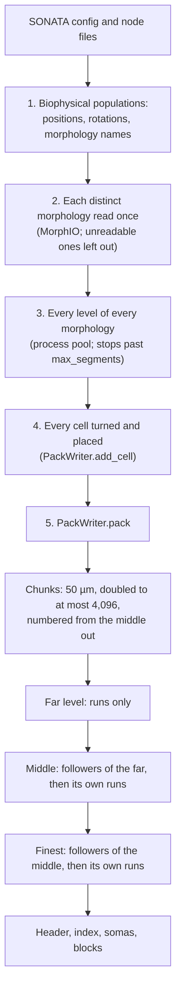

# How a pack is built

## The modules

| Module | What it owns |
| --- | --- |
| `build` | The build from a circuit's config to a pack's bytes, the reasons a circuit gets none (`NoPackError`), and the memory cap (`segment_cap`) |
| `circuit` | Reading a SONATA circuit: its biophysical populations, each cell's position, rotation and morphology name, the distinct morphologies; simplifying them over processes and placing the cells |
| `geometry` | A morphology as sections of traced points, the levels, pruning, simplification and how each level follows the next |
| `simplify` | Ramer-Douglas-Peucker in rounds: every open stretch of a morphology split at its farthest point in one numpy pass a round |
| `writer` | `PackWriter`: cells placed level by level, the chunks, the runs, what each level adds over its base, the order on disk, the index |
| `codec` | The bytes: the grid and radius steps, the index's model, a chunk's streams and their byte planes, deflate, the header |
| `reader` | A pack read back into arrays, the reader the tests hold the writer against |
| `staging` | Fetching a stored circuit's files for a build through entitysdk. OBI-One's, not the format's: see [Boundaries](#boundaries) |

## From files to bytes

`build_morphology_pack(config_path, max_segments, workers)` runs these steps in order. Each is logged as it ends, with the seconds it took.

The levels are packed coarsest first. Each level's chunks are encoded over the pool as they are cut.

1. **The populations.** The circuit's biophysical node populations, sorted by name.
   - For each: every cell's position, its rotation as a matrix, and its morphology's name.
   - The rotation comes from the quaternion attributes, or else from the rotation angles about the axes, or else none.
   - Where the morphologies are read from is the first of the population's morphology folder, its ASC and its HDF5.
2. **The morphologies.** Each distinct morphology is read once, through MorphIO.
   - A morphology is told apart by where it is read from and its name.
   - A morphology that cannot be read is left out, with a warning.
3. **The levels.** Every distinct morphology is simplified to every level, over the process pool, `MORPHOLOGIES_A_JOB` a job.
   - There is one simplification pass for each pruning length. Each level takes the points of its pass that stay kept past its own tolerance, so the levels that prune alike are nested by construction.
   - Between each level and the next, `geometry.nesting` records which of the finer level's points end segments following each coarser segment. That record is what the writer stores as counts and inner points.
   - As each morphology is done, its segments times its cells are added up. The build stops with `NoPackError` at the first morphology that takes the total past `max_segments`.
4. **The cells.** `place_cells` adds every cell to a `PackWriter`, a morphology at a time: each point turned by the cell's rotation, then moved to its position.
   - A cell without a readable morphology, or without a finite position and rotation, is a soma of radius zero.
   - Each morphology is let go of once its cells are placed.
5. **The pack.** `PackWriter.pack` writes the file:
   1. **The chunks.** Every level's segments are binned by the cube their far point lies in. The cubes start at `CHUNK_UM` a side and double until every level fits in `MAX_CHUNKS`. The boxes are the same at every level.
   2. **The boxes' numbers.** Boxes are numbered by distance from the middle of the somas' box, nearest first, ties broken by place. A reader streaming a level then has it from the middle out.
   3. **The somas block.** It is written first.
   4. **The levels, coarsest first.** Each level's points are joined only when it is packed. Its segments that follow the base's segments come first, in the order the base's chunk is read. Its own runs follow, cut where the base leaves them, ordered by chunk and then by cell.
   5. **The encoding.** Chunks are encoded over the pool, `CHUNKS_A_JOB` a job. The level's points are let go of once the finer level has been packed over them.
   6. **The index.** It is written last but placed first, after the 12-byte header. It holds the population boxes, computed from the finest level, and the bounds.

## Memory

At its peak a build holds every level's placed points and the encoded blocks of the level in hand. The cap therefore counts segments over every level.

| What | Bytes |
| --- | --- |
| The build itself, two processes | `BASE_BYTES`, 400 MiB |
| Each process past two | `BYTES_A_WORKER`, 128 MiB, measured at about 110 MB while simplifying |
| A segment, over every level | `BYTES_A_SEGMENT`, 50 |

These are counted in the memory that cannot be reclaimed. They were measured in a Linux container on 2 CPUs, 2026-10-23:

| Pack | Base | A segment |
| --- | --- | --- |
| CA1-300, whose cells share their morphologies | 300 MB | 40 B |
| Packs whose cells share none | 290 MB | 43 B |

The settings round both up.

What keeps the peak there:

- **Data is let go of as soon as its use is over.** Morphologies are released as they are sent to be simplified, shapes once their cells are placed, and a level's points once the level over it is packed.
- **Freed memory goes back to the system.** `hand_back_freed` calls glibc's `malloc_trim` after each stage and in each process after each job, where the C library has one.
- **Results are unpickled in the caller's thread.** glibc keeps a thread's allocations in an arena of its own, and what the caller frees can only be reused in its own arena.
- **Only `AHEAD` jobs per process are in flight at once.** The pool does not run ahead of what the caller has taken.

`segment_cap` turns this into the most segments a build may hold where it runs, as in the [README](README.md#limits-and-settings).
- On 16 GiB, `MAX_SEGMENTS` (300M) holds on two processes or on four: 300M × 50 B plus the base is about 14.4 GiB, and about 14.6 GiB with two more processes.
- The whole FlyWire brain's three levels come to about 255M segments.

Not built: memory bounded by a group of chunks rather than by the whole circuit. A build's memory still grows with the circuit's segments.

## The same bytes on any number of processes

A pack is the same to the byte whatever the number of processes it is built over, and whatever order its cells are added in. A change to the writer keeps this:

- **The pool returns results in the order of the work,** never in the order they finish.
- **Every order is a sort on values,** never an accident of a dict or a set:
  - populations are sorted by name;
  - morphologies are taken in the order the cells first name them;
  - runs are sorted by chunk, then by cell, with a stable sort;
  - boxes by distance, then by place.
- **A cell's points are turned one row at a time, the same way at any array length.** A matrix product of a short array rounds its last rows apart from the same rows in a long one.
- **Every block is deflated by the same zlib, at the same level and strategy.** The bytes are the same for the same zlib build. A different zlib build may deflate to other bytes that inflate to the same content.

The tests check this:
- `test_writer`: one process against two, and cells added in another order.
- `test_build`: a whole circuit on one process against several.
- `test_codec` and `test_writer`: round trips of every stream, chunk and pack against `reader.py`.

After any change to the writer, rebuild a few real packs on one process and on several, and compare the bytes. Against the writer before the change, compare the segments read back, or the bytes where the change is meant to keep them.

## Boundaries

The package is meant to leave OBI-One for a repository and a package of its own. It ties to OBI-One in these places only, and new code adds none.

| Import | Used in | On extraction |
| --- | --- | --- |
| `obi_one.utils.parallel`: `Processes`, `available_cpus`, `ALONE` | `build`, `circuit`, `writer` | Moves with the package |
| `obi_one.utils.memory`: `hand_back_freed`, `memory_left` | `build`, `writer` | Moves with the package |
| `morphologies_source` from `obi_one.scientific.library.circuit` | `build`, `staging` | Copied in: where a population's morphologies are read from, and in which format |
| `TYPES_OF_BIOPHYS_NODES`, `get_names_of_typed_node_populations` from `obi_one.scientific.library.circuit_metrics` | `circuit` | Copied in: they read only the SONATA config |
| `SONATA_CIRCUIT_ASSET_SELECTION`, `stage_circuit_nodes` from `obi_one.scientific.library.circuit_staging`, and `entitysdk` | `staging` | `staging.py` stays in OBI-One. Fetching a stored circuit's files is the asset job's work, not the pack's. |

What would import the new package instead:

| Caller | What it uses |
| --- | --- |
| `obi_one/db_sdk/registration/circuit/generate.py` | `build_morphology_pack`, `segment_cap`, `NoPackError` |
| `launch_scripts/launch_circuit_asset_generation/main.py` | `staging.stage_morphology_pack_inputs`, which stays in OBI-One |

Its other dependencies come with it:

| Dependency | Used for |
| --- | --- |
| libsonata | Reading the circuit |
| MorphIO | Reading the morphologies |
| NeuroM | The soma's radius |
| bluepysnap | The rotation matrices, from quaternions or angles |
| numpy | Every array |
| pydantic | The index's model |
| psutil | The memory left, in `obi_one.utils.memory` |

bluepysnap is a large dependency for two functions; copy them in on extraction. Its tests use small circuits and morphologies under `tests/`, which move with them.
