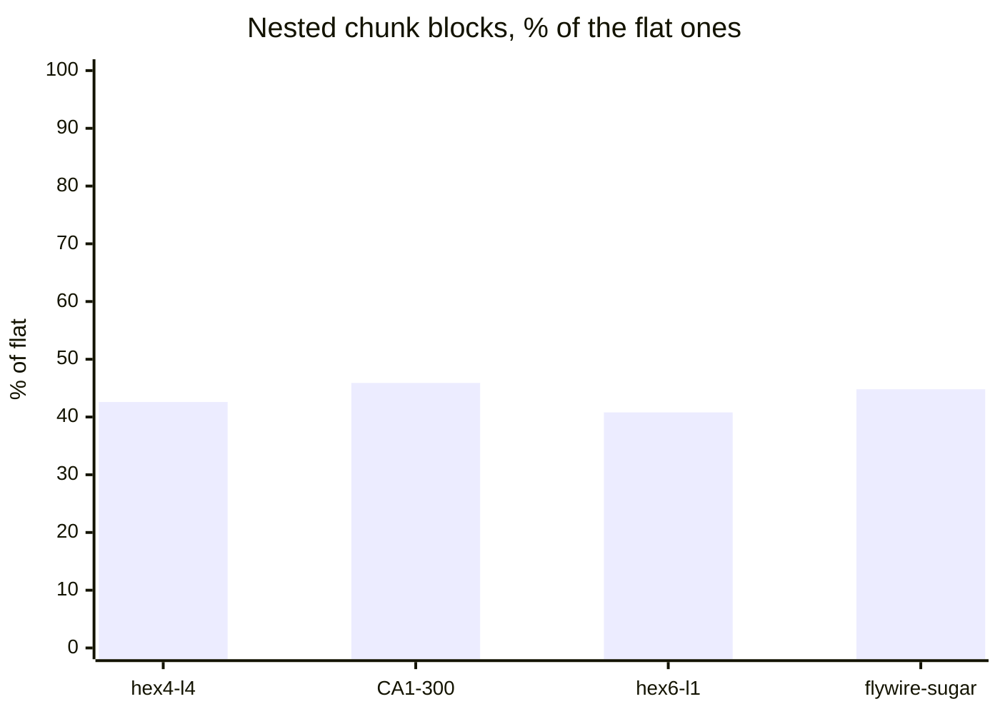
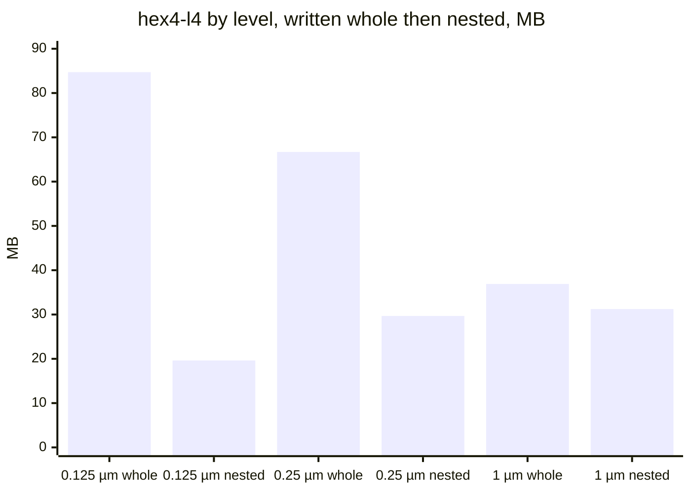
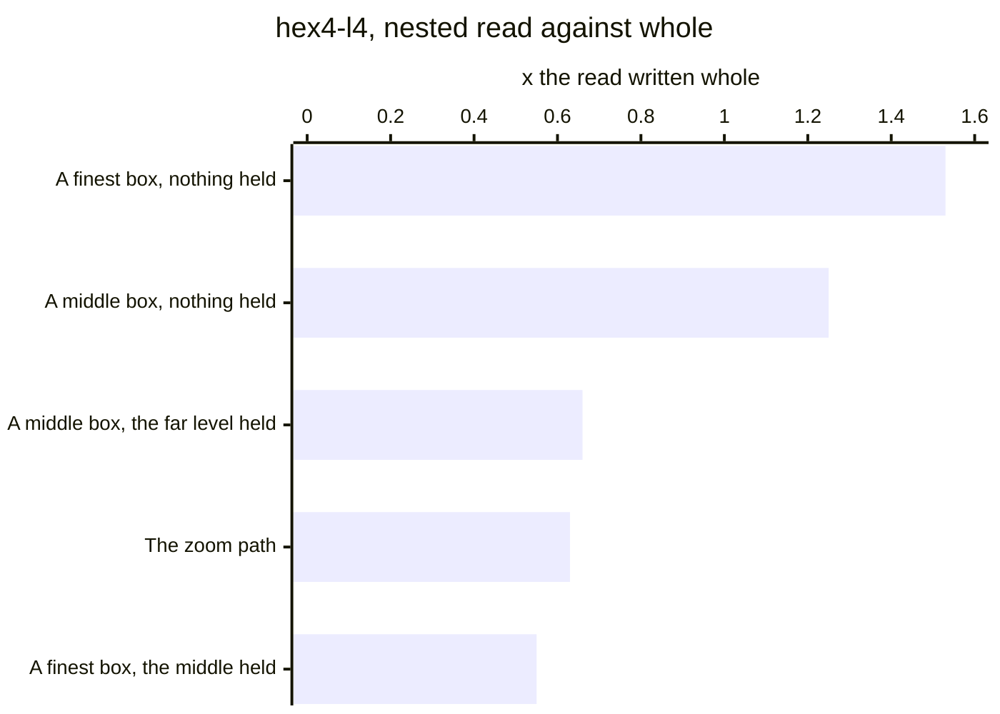
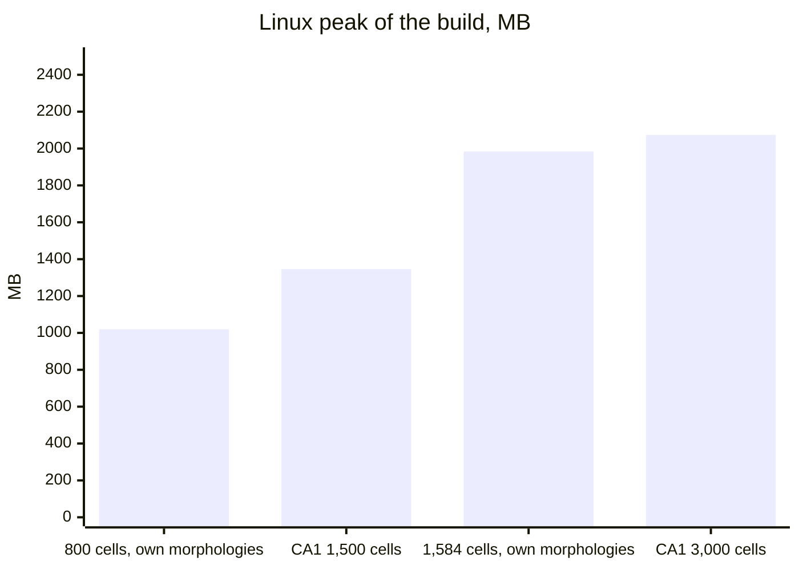
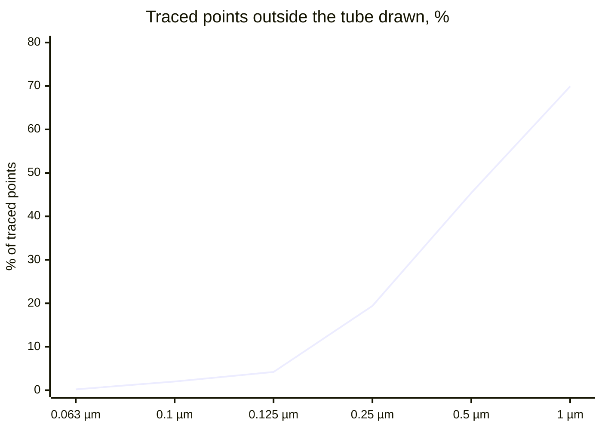
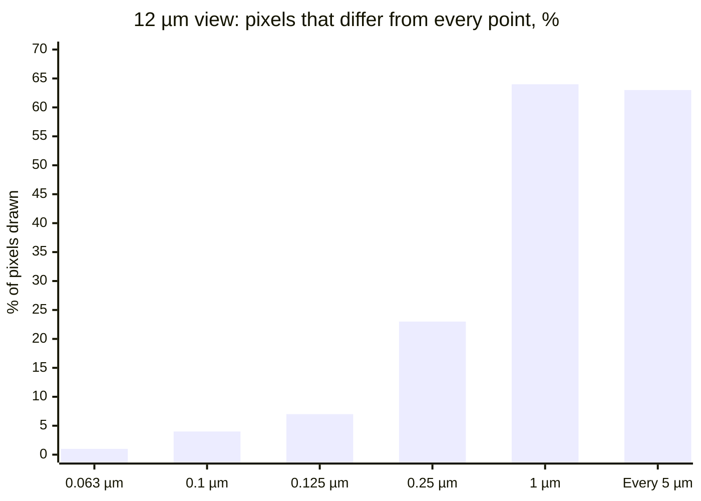

# Performance

The pack's sizes, read times, build time and memory, and fidelity, as measured. Each table gives its machine, date and pack. What was weighed against the pack, and why, is in [alternatives.md](alternatives.md).

The packs: hex4-l4 (nbS1, 5,030 cells), hex6-l1 (349 cells), CA1-300 (rat CA1, 300 cells), flywire-sugar (243 FlyWire cells), the 1,379-cell fly sample and the 291-cell rat sample (layer 1 of an nbS1 column). Two packs made of copies of the fly sample were measured too. Copies of one cell in one chunk give a coder repeats that no real circuit has, so their figures are left out.

Sizes and reads are set against the alternative that nesting was chosen over, the levels written whole: every level whole, each chunk one zlib stream at level 6, with no plane blocks and no nesting. [alternatives.md](alternatives.md) calls these the flat blocks. The sizes dated 2026-10-19 were measured without the population boxes in the index; the chunk blocks are the same bytes. CA1-300 built with the boxes, 2026-10-23, comes to the same 10.02 MB, level by level ([below](#ca1-300-built-with-every-field-of-the-index)).

## Size

### By pack

| Pack | The pack, the file | Levels written whole, the file | Chunk blocks, nested against whole |
| --- | --- | --- | --- |
| hex4-l4 | 80.65 MB | 189.0 MB | -57.4% |
| CA1-300 | 10.02 MB | 21.59 MB | -54.1% |
| hex6-l1 | 5.72 MB | 13.91 MB | -59.2% |
| flywire-sugar | not built as a file | 10.26 MB | -55.2% |

What is left of each pack's flat chunk blocks once nested, with the plane blocks and the run starts:



The last column is measured on the chunk blocks alone, nested and whole, in the same run: on hex4, 80.42 MB against 188.91 MB.

### By level

Written whole: the sum of each chunk's block deflated at level 6 in Node, within 1% of the file's bytes on every level. The pack: the file, 2026-10-19.

| Level | hex4-l4, written whole | hex4-l4, the pack | CA1-300, the pack | hex6-l1, the pack |
| --- | --- | --- | --- | --- |
| Index and somas end at | | 0.134 MB | 0.047 MB | 0.024 MB |
| 0.125 µm | 84.71 MB | 19.62 MB | 2.70 MB | 1.44 MB |
| 0.25 µm | 66.70 MB | 29.68 MB | 4.20 MB | 1.96 MB |
| 1 µm, end branches under 5 µm pruned | 36.90 MB | 31.23 MB | 3.08 MB | 2.29 MB |
| In all | 188.32 MB of chunk blocks | 80.65 MB | 10.02 MB | 5.72 MB |



The far level, the base, is read alone and holds runs only, so nesting changes only the two finer levels. On hex4 the far level is 31.23 MB where written whole it is 36.90 MB, by the run starts and the plane blocks.

## Bytes a segment in a level written whole

Where the bytes go when a level is written whole, hex4-l4, each stream's share of a level in the order the format stores them (2026-10-18). This is what nesting and the run starts were weighed on.

| Level | Bytes a segment | Bytes a run | Segments a run | Steps x, y, z | Radius step | Run start x, y, z | Run start radius, cell, type, length | Runs starting outside their chunk |
| --- | --- | --- | --- | --- | --- | --- | --- | --- |
| 0.125 µm | 4.17 | 52.2 | 12.5 | 82.4% | 4.9% | 9.9% | 2.7% | 44.2% |
| 0.25 µm | 4.62 | 41.6 | 9.0 | 79.3% | 4.8% | 12.6% | 3.2% | 44.4% |
| 1 µm, pruned 5 µm | 6.17 | 24.9 | 4.0 | 69.5% | 4.1% | 21.3% | 5.0% | 46.5% |

- **A run costs a near-constant 6.5 B** besides its segments, 5.2 B of it the x, y, z start. The starts take 13.7-14.0 bits an axis, near the 12.97 bits of a place in a chunk of 8,000 steps, so no context lowers them. The run's share is set by its segments: on hex6-l1 17.7 / 21.9 / 33.8% by level, on flywire-sugar 25.9 / 32.8 / 42.1%.
- **Deflate is at the streams' zeroth-order entropy** on hex4's finest and middle levels, 1.1% and 0.4% under it, and 3.7% above it on the far level.
- **Small chunks are many and light.** At hex4's finest level 1,941 of 3,164 chunks are under 1 KB and hold 0.7% of the bytes; 19 chunks of 1 MB and over hold 55.8%.
- **Nested, plain, without the chord's guess:** an inner point of the finest level costs 4.19 B, about a whole finest segment's 4.17. The middle over the far costs 2.49 B a middle segment.

The first review's per-morphology packs, every traced point, a block a morphology and an index, deflate at level 9: 2.99 B a point on flywire-sugar's cells, 3.00 on the fly sample, 2.59 on the rat sample. On the fly cells a point takes 3.0 B at every point, 3.3 within 0.1 µm and 5.0 within 1 µm: points further apart take more bytes each.

## Read time

### In Node, nested against whole

One thread, inflate and decode into the reader's arrays, 2026-10-19. hex4-l4 and hex6-l1 were measured nested without the plane blocks and the run starts; CA1-300 is the pack itself. Each figure is against the levels written whole in the same run.

| Read | hex4-l4, like for like | hex4-l4, first timing | hex6-l1, like for like | CA1-300, the pack |
| --- | --- | --- | --- | --- |
| A finest box, nothing held | 1.53x | 1.45x | 1.58x | 1.06x |
| A middle box, nothing held | 1.25x | 1.19x | 1.31x | 1.07x |
| The far level | | | | 0.75x |
| The zoom path: the far level held, the middle then the finest | 0.63x | 0.60x | | 0.91x |

hex4-l4 like for like, and the two warm reads of the first timing, as a multiple of the read of the levels written whole. Under 1 is faster:



- **Bytes fetched on hex4,** the first timing: a finest box with nothing held 1.15x, a middle box 1.09x. The zoom path fetches 60.52 MB, against 151.41 MB written whole (0.40x).
- **With a level held:** a finest box over a middle held fetches 0.29x and decodes 0.55x; a middle box over a far held fetches 0.54x and decodes 0.66x (hex4, first timing).
- **The chord's guess costs nothing to read,** within 2% of plain additions on every pack.
- **"Like for like"** times both through decoders of one shape. The first timing used two shapes, which put the cold ratios 0.05-0.07 low on hex6 and left the warm and zoom ratios where they were.

### In the browser

The first review's per-morphology packs, read in headless Chrome 148 on the M4 Pro, one thread, five rounds, the file from the same machine. A segment is 8 floats, as the GPU takes them.

| Step | 243 fly cells | 1,379 fly cells | 291 rat cells |
| --- | --- | --- | --- |
| Inflate the blocks | 22-25 ms | 48-56 ms | 33-36 ms |
| Blocks into segments | 17-19 ms | 21-22 ms | 33-37 ms |
| The whole read, a block at a time | 39-45 ms | 68-75 ms | 66-75 ms |
| Inflate the same bytes as one stream | 19-20 ms | 23-24 ms | 29-31 ms |

The same reader in Node inflates in 9-13 ms and writes segments in 9-10 ms per million points.

One level written whole, in chunks: the first 150 cells of CA1, 1,322,919 segments in 1,562 chunks, 5.36 MB. Headless Chromium on the M4 Pro, 2026-10-13.

| Read | Time |
| --- | --- |
| The read alone, on the page or in a worker | 72 ms; 77-79 ms in later runs; inflating is 34 ms of it |
| Through the worker, from the network | 100 ms, 98-126 over five rounds |
| Through the worker, from the browser's cache | 89 ms, 89-94 |

hex6-l1 streamed in Chrome, 2026-10-21, 5,720,383 bytes sent at 1.5 MB/s: the pack's somas replaced the page's 1 s into a 19 s download, and the base came in as it landed. Reopened from the cache, it opened in about 0.1 s.

Not measured: a nested pack's read in the browser, the browser's inflate on any coding option, and a read over a real network.

## Build

### Time

The steps of a build, timed on a prototype in OBI-One's environment (Python 3.12, MorphIO, numpy 2.4) on one core of the M4 Pro. The 1,379 fly cells written as SWC files: 94 MB, 2.1M points.

| Step | ms per million points |
| --- | --- |
| Read the SWC files, MorphIO | 398 |
| Write the streams, numpy | 118 |
| Deflate, a block a morphology | 62-67 |
| Simplify to 0.25 µm, a numpy call a split | 4,029 |
| The same in rounds, every section of a morphology at once | 290-360 |

Built on request in the service, the alternative [ADR 0015](adr/0015-built-in-the-asset-job.md) rejected, with files read, simplified within 0.125 µm, placed, cut into 50 µm chunks and deflated: 1.9 s for the fly sample's 2.1M traced points, 2.5 s for the rat sample's 3.1M. That is 0.8 to 0.9 s per million traced points.

The writer, CA1's first cells, in a Linux container held to 2 CPUs, 2026-10-22:

| Cells | Distinct morphologies | Segments, every level | Time |
| --- | --- | --- | --- |
| 600 | 429 | 9.5M | 7.6 s |
| 1,500 | 794 | 23.5M | 14.3 s |
| 3,000 | 1,114 | 46.8M | 22.9 s |
| 1,584, one morphology each | 1,584 | 36.7M | 28.5 s |

With no morphology shared, that is about 0.8 s a million segments.

On the Mac, 2026-10-23, three runs each: CA1's first 1,500 cells on 2 processes build in 10.7-10.8 s; the fly sample five times over packs in 3.80-3.82 s on 1 process. The 1,500-cell build's 10.3 s untraced: reading 0.5 s, simplifying 4.7 s, placing 1.6 s, packing 3.3 s. Simplifying grows with the distinct morphologies and is half the build.

What the format adds to the writer, hex4-l4 and CA1-300, 2026-10-19:

- **Plane blocks:** 1.03-1.14x the compress time on hex4's 200 µm chunks, 1.2-1.4x on 100 µm chunks.
- **Run starts referred back, and the guess:** 4.4 s on hex4's far level and residual, against 2.5 s to encode them.
- **Nesting:** 0.09 s on CA1's 249 distinct morphologies, against 1.8 s to simplify them.

### Peak memory

2026-10-23. Linux: a container held to 2 CPUs with no swap, the anonymous memory at its peak, which is what an out-of-memory kill counts.

| Run | Segments | Peak |
| --- | --- | --- |
| CA1 1,500 cells | 23.5M | 1,346 MB |
| CA1 3,000 cells | 46.8M | 2,074 MB |
| 800 cells, one morphology each | 12.8M | 1,020 MB |
| 1,584 cells, one morphology each | 36.7M | 1,984 MB |



A build holds the most a segment where cells share no morphology.

The Mac, live arrays in the main process at the peak, as tracemalloc counts them: 634 MB for CA1's 1,500 cells, 388 MB for 800 distinct cells. The Mac's process size only grows, so it cannot stand in for the Linux peak.

### Memory a segment of the build

Fitted on the cgroup's peak less page cache, Linux, 2026-10-23:

| Cells | Fixed | Bytes a segment |
| --- | --- | --- |
| Sharing morphologies (CA1 300, 1,500, 3,000 cells) | 299 MB | 40.3 B |
| One morphology each (300, 800, 1,584 cells) | 286 MB | 43.3 B |

Each process past two holds about 110 MB more while simplifying.

### The cap

A pack built on a machine holds at most:

```python
base = BASE_BYTES + BYTES_A_WORKER * max(0, processes - 2)
cap = min(max(0, left - base) // BYTES_A_SEGMENT, MAX_SEGMENTS)
```

`left` is the memory the container leaves the build, once what the process freed is handed back.

| Constant | Value |
| --- | --- |
| `BASE_BYTES` | `400 * 2**20`, 400 MiB |
| `BYTES_A_WORKER` | `128 * 2**20`, 128 MiB |
| `BYTES_A_SEGMENT` | 50 |
| `MAX_SEGMENTS` | 300,000,000 |
| `MAX_WORKERS` | 8 |

| Memory of the machine | Cap |
| --- | --- |
| 4 GB | about 70M segments |
| 16 GB | `MAX_SEGMENTS` |

## Fidelity

The first review, the whole fly brain as the 1,379-cell sample times 100.5, each level held against the traced points. Off the path: each traced point's distance to the simplified path of its section.

| Level | Points | Off the traced path: 99 in 100 · worst | Points off by more than their radius | Length kept |
| --- | --- | --- | --- | --- |
| Every point | 212M | | | 100.0% |
| Within 0.063 µm | 189M | 0.055 · 0.063 µm | 0.2% | 99.9% |
| Within 0.1 µm | 163M | 0.091 · 0.1 µm | 2.0% | 99.7% |
| Within 0.125 µm, the finest level | 146M | 0.115 · 0.125 µm | 4.2% | 99.4% |
| Within 0.25 µm, the middle level | 91.4M | 0.229 · 0.25 µm | 19.4% | 97.6% |
| Within 0.5 µm | 52.7M | 0.448 · 0.5 µm | 45.4% | 94.3% |
| Within 1 µm | 33.3M | 0.876 · 1 µm | 69.9% | 90.2% |
| A point every 5 µm, every neurite | 36.5M | 1.11 · 2.19 µm | 67.1% | 88.2% |

The far level also prunes end branches under 5 µm, which this table does not.

The share of traced points that lie outside the tube drawn, by tolerance. It stays small to 0.125 µm, the finest level, and climbs past it:



Pixels that differ from every point, and of those, the ones a shift of a pixel does not explain. The fly sample, 1,280 × 960 pixels, 4x MSAA; a pixel differs where a channel is more than 24 of 255 off.

| View | µm a pixel | 0.063 µm | 0.1 µm | 0.125 µm | 0.25 µm | 1 µm | Every 5 µm |
| --- | --- | --- | --- | --- | --- | --- | --- |
| The whole sample | 0.7 | 1% · 1% | 4% · 3% | 6% · 5% | 16% · 12% | 48% · 32% | 46% · 31% |
| 60 µm of it | 0.0625 | 2% · 1% | 5% · 2% | 8% · 3% | 23% · 11% | 56% · 47% | 56% · 46% |
| 12 µm | 0.0125 | 2% · 1% | 6% · 4% | 10% · 7% | 27% · 23% | 66% · 64% | 65% · 63% |
| 4 µm | 0.004 | 3% · 2% | 9% · 8% | 12% · 10% | 30% · 28% | 76% · 75% | 74% · 73% |

The 12 µm view, the pixels a shift of a pixel does not explain:



The far views overstate it. At 0.7 µm a pixel a fibre is a line a pixel wide over others, and a shift of part of a pixel changes which is on top; the pictures cannot be told apart by eye.

- **The grid:** read back, every segment's ends are within 12.5 nm and its radius within 2.2%.
- **Nesting is exact.** Decoded, the nested levels give the segments of the levels written whole, one to one: on hex4-l4 14,421,328 middle and 20,292,212 finest segments; on CA1-300 every level, by both readers (2026-10-19).

## CA1-300 built with every field of the index

The first 300 cells of CA1's `hippocampus_neurons`, built as the asset job builds them, on the M4 Pro, 2026-10-23, three rounds.

| Level | Segments | Bytes | Bytes a segment | Chunks |
| --- | --- | --- | --- | --- |
| Index and somas end at | | 0.047 MB | | |
| 0.125 µm, over the middle | 2,547,377 | 2.698 MB | 1.06 | 1,799 |
| 0.25 µm, over the far | 1,729,458 | 4.197 MB | 2.43 | 1,799 |
| 1 µm, end branches under 5 µm pruned | 528,322 | 3.079 MB | 5.83 | 1,798 |
| In all | 4,805,157 | 10.02 MB, 10,021,520 B | 2.09 | |

| Processes | Build | Largest resident size of the main process |
| --- | --- | --- |
| 1 | 3.97-4.03 s | 727-834 MB |
| 2 | 3.69-3.75 s | 823-836 MB |
| 4 | 3.08-3.12 s | 751-832 MB |

- **The same bytes on 1, 2 and 4 processes,** in every round.
- **The resident size is the Mac's,** which only grows; it cannot stand in for a Linux container's peak.

Not measured yet: hex6-l1 and flywire-sugar built the same way. Their circuits are on staging only.
